# hvec

**A Rust sandbox for homomorphic compression of embedding vectors, aimed at vector databases.**

Blog and experiment write-ups: [swinecoder101.github.io/hvec](https://swinecoder101.github.io/hvec/)

<p align="center">
  
</p>

> Status: early experimental. The tooling for phases 1 to 6 is in place: shell and CLI, model
> connectors, seven codec families (`f32`, `int8`, `binary`, `binary-centred`, `pq<m>`, `mrl<k>`
> and `mrl<k>+<codec>`), `bench recall` against the f32 ranking and against relevance judgments, a
> BEIR importer, `bench run` across the matrix with a payload stage, `report`, an LLM judge and an
> agent memory-loop benchmark. Four retrieval experiments are published. The answer-level
> experiments (two chat models) are scripted and waiting on API access. Expect APIs and results to
> change without notice. Contributions and experiments are welcome; see [CONTRIBUTING.md](CONTRIBUTING.md).

## What is homomorphic compression?

A compression scheme is *homomorphic* with respect to an operation when you can perform that
operation directly on the compressed representation and get the same (or a controlled
approximation of the same) result you would get on the original data. You never have to
decompress.

For vector search the operations that matter are:

- inner product and cosine similarity,
- Euclidean (L2) distance,
- top-k nearest-neighbour selection built on the two above.

If a codec preserves these operations, a vector database can store compressed vectors, scan them
compressed, and rank them compressed. That cuts memory, bandwidth, and cache pressure at the
hottest part of the query path.

Familiar techniques already sit on this spectrum, even if they are rarely named this way:

| Technique | Compressed-domain op | Trade-off |
|---|---|---|
| Scalar / int8 quantization (`int8` in hvec) | Approximate dot product | Small loss, ~4x smaller |
| Binary / 1-bit quantization (`binary` in hvec) | Sign agreement as a proxy | Large loss, ~32x smaller |
| Mean-centred binary (`binary-centred` in hvec) | Sign agreement after subtracting the corpus mean | Same size as binary; the loss depends on how centred the model's vectors are |
| Product quantization (`pq<m>` in hvec) | Per-subspace centroid distance, summed | Tunable loss, 8-64x smaller; needs trained codebooks |
| Matryoshka truncation (`mrl<k>` in hvec, composable as `mrl<k>+int8`) | The metric on a prefix of the vector | Near-free on models trained for it, a plain lossy projection otherwise |
| Random projections / JL sketches | Approximate inner product | Provable error bounds |
| Homomorphic encryption (CKKS and friends) | Exact ops on ciphertext | Privacy, heavy compute |

hvec is a place to implement these side by side in Rust, measure them honestly, and explore the
gaps between them. It does this with a CLI that runs a real retrieval-augmented generation (RAG)
pipeline end to end: ingest documents, store their embeddings through a codec, retrieve in the
compressed domain, ask a chat model, and record every stage's cost and outcome. The question hvec
exists to answer is not "what is recall@10" but "does this compression change the answers a given
model gives, and by how much".

## Where hvec sits

Two kinds of compression touch a retrieval-augmented agent, and they are easy to confuse.

| | Key compression | Payload compression |
|---|---|---|
| What is compressed | The embedding vectors the store searches by | The text the model reads: tool output, logs, RAG chunks, history |
| Where it acts | Inside the vector store, before retrieval | Between retrieval and the model, in the prompt |
| What it changes | Which passages come back | How many tokens the model sees |
| Example | int8, binary, product quantization | [Headroom](https://github.com/headroomlabs-ai/headroom), LLMLingua, summarisation |
| hvec's role | **Implements and measures it** | **Measures it as a stage in the pipeline** (`--payload`) |

Headroom and tools like it are production layers that save tokens. hvec is a measurement
harness. It does not sit in your request path and it does not make anything cheaper by itself.
It answers a question those tools cannot answer about themselves: for a given embedding model,
codec, payload compressor and chat model, did the answers change, and by how much. The two are
complementary. A Headroom-style stage is an axis of the hvec benchmark matrix (`--payload
http:<url>` hands the retrieved passages to a local compressor service), so the combined effect
of compressing the key and the payload is measured in one run log.

## Goals

- **Implement** a family of compressed-domain similarity codecs behind a shared trait.
- **Measure** recall, distance error, throughput, and memory, and then the thing that matters:
  end-to-end answer quality per chat model, with reproducible runs.
- **Explore** the boundary between lossy compression and privacy-preserving computation. The
  encryption side (computing similarity on encrypted vectors) is in scope as an experiment track.
- **Stay small.** This is a research sandbox, not a database. Results should be easy to lift
  into real systems.

## Non-goals

- Building a full vector database, indexing service, or network API.
- Production hardening or stability guarantees.
- Competing with mature libraries on raw speed before the ideas are proven.

## Layout

```
hvec/
├── crates/
│   ├── hvec-core/      # Codec trait, Metric, distance kernels, the codecs
│   ├── hvec-connect/   # ChatModel + Embedder traits; Anthropic, OpenAI-compatible, local ONNX
│   ├── hvec-store/     # SQLite: collections, compressed-domain search, sessions, run log
│   ├── hvec-bench/     # Chunking, prompts, question sets, BEIR import, metrics, judge, payload, memory
│   └── hvec/           # The CLI
├── experiments/        # One directory per experiment with its write-up
├── questions/          # Question sets and memory scripts
├── CONTRIBUTING.md
└── README.md
```

The benchmark is a matrix: **embedding model × codec × payload stage × chat model × dataset**. Compression behaviour depends on the embedding model
(dimension, distribution, normalisation). Tolerance to degraded retrieval depends on the chat
model. hvec keeps every axis explicit in every run record.

## Getting started

You need a stable Rust toolchain (1.85 or newer). Install it with [rustup](https://rustup.rs).

```sh
git clone https://github.com/SwineCoder101/hvec.git
cd hvec
cargo build --release
cargo test
```

The binary is at `target/release/hvec`. Put it on your `PATH` or run it as `cargo run --release --`.
Then type `hvec`. With no subcommand it writes a starter config if needed and opens an interactive
session. The sections below describe that shell and the scriptable subcommands behind it.

The default build includes the local embedding backend, which pulls in ONNX Runtime. If you only
want remote embedders, build with `cargo build --release --no-default-features`. See
[Troubleshooting](#troubleshooting) for the macOS SDK requirement.

## How to use the CLI

### The interactive shell

```sh
export ANTHROPIC_API_KEY=sk-ant-...
hvec
```

```
hvec 0.1.0 | config ~/.config/hvec/config.toml | db ~/.local/share/hvec/hvec.db
session    20261008-161918 (0 messages)
collection none (plain chat, no retrieval; use /use <collection>)
chat       anthropic (claude-opus-5-5) | k=5 | show-context=false
Type a question, or /help for commands. Ctrl-D or /quit to exit.

hvec> /new handbook docs/
ingested 212 chunks from 31 files into `handbook` in 4.1s (384 dims, codec f32, 212 chunks total)
hvec[handbook]> What is our refund policy?
...
[claude-opus-5-5 | f32 | k=5 | embed 8ms, retrieve 1ms, generate 2310ms | 1480 in / 212 out tokens | recorded]
```

Plain text is a question. If a collection is selected the shell retrieves passages first and
records the turn in the run log; without one it is plain chat and nothing is recorded. Every
launch creates a new timestamped session unless you pass `-s <name>`, and the transcript is saved
so `hvec -s <name>` resumes it. If exactly one collection exists it is selected automatically.

| Command | Effect |
|---|---|
| `/use <name>`, `/use none` | Select a collection, or turn retrieval off |
| `/new <name> <paths...>` | Create a collection by ingesting files or directories |
| `/ingest <paths...>` | Add files to the current collection |
| `/model [name]` | List chat profiles, or switch to one for the next turn |
| `/session <name>` | Switch to or create a session |
| `/k <n>` | Passages to retrieve per turn |
| `/context` | Toggle printing the retrieved passages |
| `/status`, `/collections`, `/sessions`, `/runs [n]`, `/embedders` | Inspect state |
| `/quit` | Exit. Ctrl-D works too |

Switching models inside one session is the point: ask the same question under `/model anthropic`
and `/model ollama` and both turns land in the run log with the same session name and collection.

Flags: `hvec -s <session> -c <collection> --chat <profile> -k <n>`. `hvec chat` is an alias.

### Scriptable subcommands

Everything the shell does is also a subcommand, for scripts and benchmarks.

### 1. Create a config

```sh
hvec config init
hvec config path      # where it was written
hvec config show      # resolved values, including the database path
```

The starter config defines several profiles. The defaults are Claude Opus 5.5 for chat and a local
`bge-small-en-v1.5` model for embeddings, so the only secret you need is:

```sh
export ANTHROPIC_API_KEY=sk-ant-...
```

Other profiles in the starter file cover OpenAI, a local Ollama server, and OpenAI-compatible
embeddings. Edit the file, or add your own `[chat.<name>]` and `[embed.<name>]` tables. Any server
that speaks the OpenAI `/chat/completions` or `/embeddings` protocol works with `provider = "openai"`.
Set `HVEC_CONFIG` or pass `--config` to use a different file.

### 2. Ingest documents

```sh
hvec ingest docs/ notes.md --collection handbook
```

Directories are walked recursively for `md`, `txt`, `markdown` and `rst` files (change with
`--ext`). Text is split into overlapping word windows (`--chunk-words 200 --overlap-words 40`),
embedded in batches, encoded with the chosen codec (`--codec int8`, `pq48`, `mrl256+int8`, …)
and stored. The first run downloads the local embedding model to your cache directory. A
collection remembers which embedding model built it and refuses to mix in another. Models trained
with task prefixes (nomic-embed, E5) take `query_prefix` and `document_prefix` in their profile.

```sh
hvec collections list
hvec embedders        # every local model the build can download
```

### 3. Ask a question

```sh
hvec query "What is our refund policy?" --collection handbook
hvec query "What is our refund policy?" --collection handbook --chat ollama -k 8 --show-context
```

`query` embeds the question, retrieves the top `k` passages in the compressed domain, builds a
fixed prompt, calls the chat model, prints the answer, and appends a run record. Pass `--json` to
get the whole record on stdout, or `--no-record` to skip the log.

### 4. Hold a conversation

```sh
hvec -s onboarding -c handbook
```

This is the shell described above. Each turn retrieves fresh context for the new question while
the earlier turns are replayed as plain history. Run the same command again to resume.

```sh
hvec sessions list
hvec sessions show onboarding
```

### 5. Inspect the run log

```sh
hvec runs list
hvec runs show 6b36a758        # id prefix is enough
```

Every `query` and every chat turn records the collection, embedding model and dimension, codec,
metric, chat profile and the model id the provider actually served, plus timings for embed,
retrieve and generate, token counts, the retrieved chunk ids and scores, the prompt version, the
question and the answer. This table is the raw material for the benchmark matrix.

### 6. Measure codecs without a chat model

```sh
hvec bench recall --collection handbook                      # int8, binary and binary-centred vs f32
hvec bench recall --collection handbook --codecs binary -k 20 --sample 500
hvec bench recall --collection handbook --queries questions.txt --json
```

`bench recall` takes an f32 collection as ground truth, re-encodes every vector with each codec,
and ranks a set of queries both ways. It reports recall@k against the exact ranking, top-1
agreement, mean and maximum score error, bytes per vector, compression ratio, and encode and scan
time. Queries are stored vectors by default, each excluding itself, or lines from a file embedded
with the collection's own embedder. Every codec's result is a `recall` row in the run log.

Codecs come in two kinds. `f32`, `int8`, `binary` and `mrl<k>` are stateless: a vector encodes
the same way regardless of its neighbours. `binary-centred` (subtract the corpus mean, then sign
bits) and `pq<m>` (`m` subspaces, k-means codebooks of 256 centroids each, one byte per subspace)
are *trained*: they have to see the corpus first. `bench recall` fits them on the collection it
is measuring. `ingest --codec pq48` fits on the first ingest into a collection, stores the
parameters alongside the collection, and reuses them for every later ingest, so make the first
call a representative sample of the corpus rather than a single file. `mrl<k>` keeps the first
`k` dimensions (what Matryoshka-trained models are built for) and composes with any other codec:
`mrl256+int8`, `mrl128+pq16`.

With a question set that carries relevance judgments, `bench recall --questions` also reports
nDCG@k and document recall@k against the labels, for every codec and for the f32 ceiling:

```sh
hvec questions import-beir path/to/scifact --out questions/scifact.jsonl --corpus-out corpus/
hvec ingest corpus/ --collection scifact --ext txt --chunk-words 200 --overlap-words 0
hvec bench recall --collection scifact --questions questions/scifact.jsonl --codecs int8,binary,pq48
```

The importer reads a BEIR dataset directory (`corpus.jsonl`, `queries.jsonl`, `qrels/`), writes
one `<id>.txt` per document so that chunks carry their document id, and turns every judged query
into a question with a `relevant` list. For SciFact, `--scifact-claims claims_dev.jsonl` from the
original release adds supports/refutes gold answers.

Measured on BEIR SciFact (8,036 chunks, `bge-small-en-v1.5`, 384 dims, cosine, the 300 test
claims as queries, k=10, release build):

```
codec            recall@k    top1   mean err    max err    bytes   ratio encode ms  scan ms
f32                1.0000   1.000    0.00000    0.00000     1536    1.0x         1     1203
int8               0.9870   0.997    0.00049    0.00340      392    3.9x         2      538
binary             0.6110   0.700    0.30665    0.45795       48   32.0x        10      310
binary-centred     0.6560   0.727    0.04821    0.28495       48   32.0x        11      600
```

Three things to read off this. int8 is close to free: 3.9× smaller, recall within two percent,
score error below a thousandth. Binary loses four neighbours in ten on this embedding model, and
its scores are far from the exact cosine because BGE vectors share a large common component, so
most sign bits agree across the corpus. Centring fixes the scores (six times smaller error) but
recovers only four or five points of recall: one bit per dimension cannot separate neighbours
whose cosines differ by less than its resolution, whatever the origin is. Against the human
relevance judgments the picture is gentler: binary loses 4.4 points of nDCG@10 (0.698 to 0.654),
not 39, because the neighbours it reorders are near-ties that are rarely the judged abstract.
The f32 scan is slow only because the baseline decodes each vector; the other codecs score the
bytes directly. The experiments are written up under [`experiments/`](experiments/).

### 7. Run the matrix and report

Ingest the same corpus into one collection per codec, write a question set, and run every
question against every collection and chat profile:

```sh
hvec ingest docs/ --collection hb-f32
hvec ingest docs/ --collection hb-int8   --codec int8
hvec ingest docs/ --collection hb-binary --codec binary

cat > questions/handbook.jsonl <<'JSONL'
{"id": "q1", "question": "What is the refund window?", "answers": ["30 days", "thirty days"], "source": "refunds.md"}
{"id": "q2", "question": "How long does standard shipping take?", "answers": ["three to five business days", "3-5 business days"], "source": "shipping.md"}
JSONL

hvec bench run --questions questions/handbook.jsonl --collections hb-f32,hb-int8,hb-binary --chat anthropic,ollama -k 5 --label exp1
hvec report                       # every bench run, grouped by cell
hvec report --batch 3f9a1c2e      # one batch; the id is printed by bench run
hvec report --set handbook --json
```

Each question becomes one `bench` row per cell with the answer, the gold answers, two cheap
scores (`exact`: normalised answer equals a gold answer; `contains`: normalised answer contains
one) and, when the question names a `source` or a `relevant` list, whether retrieval hit it, plus
nDCG and document recall for judged questions. Model errors are recorded, counted and skipped
rather than aborting the batch; `--fail-fast` reverses that. `report` groups rows by question
set, collection, embedding model, codec, payload stage and chat model and prints accuracy over
the questions with gold answers, retrieval hit rate, nDCG, latency and tokens per cell, and flags
runs that a provider served with a different model than configured. See
[questions/README.md](questions/README.md) for the file format.

### 8. Grade answers with a judge model

```sh
hvec judge run --batch 3f9a1c2e --judge anthropic-sonnet
hvec judge agreement --batch 3f9a1c2e
hvec report --batch 3f9a1c2e      # now with judged / faithful columns
```

The cheap scores miss paraphrases and accept substrings. `judge run` asks a second, cheaper
model to grade every recorded answer twice: *correct* against the gold answers (null when the
question has none) and *faithful* to the passages it was generated from, which are fetched back
by chunk id. Verdicts are `judge` rows pointing at their bench run; the judge prompt is versioned
like the RAG prompt. `judge agreement` reports how often the judge and the cheap rules agree, and
counts the two kinds of disagreement, so the judge can be trusted (or not) before its numbers are
used. Runs that already have a verdict are skipped unless `--rejudge`.

### 9. Compress the payload too

```sh
hvec query "refund policy?" --collection handbook --payload truncate:60
hvec bench run --questions questions/handbook.jsonl --collections hb-f32,hb-binary --payload http://localhost:8080/compress
```

The payload stage sits between retrieval and the prompt. `none` sends the passages as retrieved;
`truncate:<words>` is the naive baseline; `http:<url>` POSTs `{"question", "passages": [{"source",
"ordinal", "text"}]}` to a compressor running as a local service and expects the same passages
back with their text replaced, which is a few lines of shim around Headroom or LLMLingua. Every
run records the stage, its latency and the context size before and after it, and `report` keys
cells by it, so key compression and payload compression can be crossed in one batch.

### 10. Replay an agent's memory loop

```sh
hvec bench memory --script questions/memory-smoke.jsonl --codecs f32,int8,binary,pq48
```

An agent writes tool results and turns into its store far more often than it reads, and reads
back what it wrote minutes ago. A memory script replays that: `write` steps append text to a
fresh memory collection, `ask` steps retrieve from it and answer. The script runs once per codec
and every step is a `memory` row with bytes stored, cumulative bytes, retrieval and generation
latency, tokens and the answer scores, followed by a per-codec summary.

## Troubleshooting

**macOS: linker error about `MLComputePlan` or `MLOptimizationHints`.** The prebuilt ONNX Runtime
that the local embedder uses needs the macOS 14.4 SDK or newer. Older Command Line Tools ship
SDK 14.0. Either update the Command Line Tools, or point the build at a newer SDK from Xcode:

```sh
export SDKROOT=$(xcrun --sdk macosx --show-sdk-path)        # if xcode-select points at Xcode
# or explicitly
export SDKROOT=/Applications/Xcode.app/Contents/Developer/Platforms/MacOSX.platform/Developer/SDKs/MacOSX.sdk
cargo build --release
```

Or skip the local embedder entirely with `--no-default-features` and use a remote embedding profile.

**`profile x needs environment variable Y to be set`.** The named profile has an `api_key_env`.
Export that variable, or remove the key from the profile for servers that need no auth.

**`collection was built with <model>; refusing to mix in <other>`.** Collections are bound to one
embedding model. Ingest into a new collection name instead.

## Experiments

Each experiment lives in its own directory under `experiments/` and ships with a short write-up:
the hypothesis, the dataset, the baseline, the metric, and the result. Negative results are kept.
Finished write-ups are published on the [project site](https://swinecoder101.github.io/hvec/experiments/).
See the experiment section of [CONTRIBUTING.md](CONTRIBUTING.md) for the template.

## Testing

```sh
cargo test --workspace
```

Unit tests cover the codecs, distance kernels, chunker, metrics, question sets, BEIR import,
judge, payload stage, memory scripts, config and store. Integration tests in `crates/hvec/tests/`
drive the real binary through ingest, query, chat, sessions, the benchmarks, the judge, the
payload stage and the memory loop against an in-process mock of the Anthropic and OpenAI APIs
(which also plays the judge and a payload compressor), using a deterministic word-hashing
embedder so no model download or API key is needed. They assert the wire format of every request,
the run-log contents, session persistence and refusal handling. CI runs them on every push.

## Contributing

Bug reports, experiment proposals, benchmark additions, and documentation fixes are all welcome.
Read [CONTRIBUTING.md](CONTRIBUTING.md) before opening a pull request. The plan is in
[ROADMAP.md](ROADMAP.md).

## License

hvec is released under the [MIT License](LICENSE).
